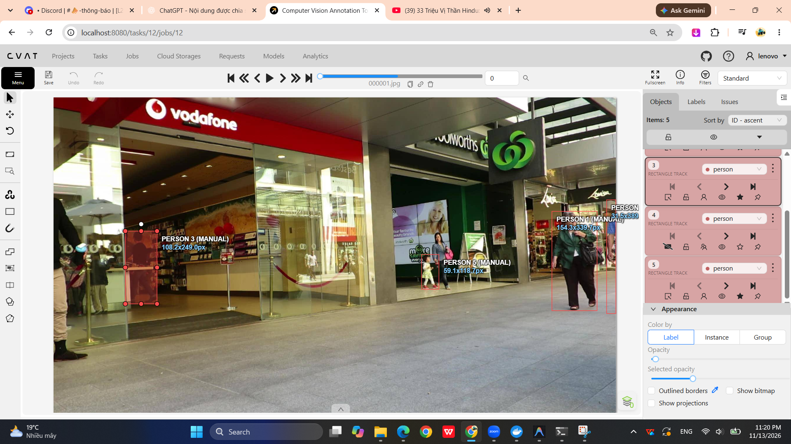
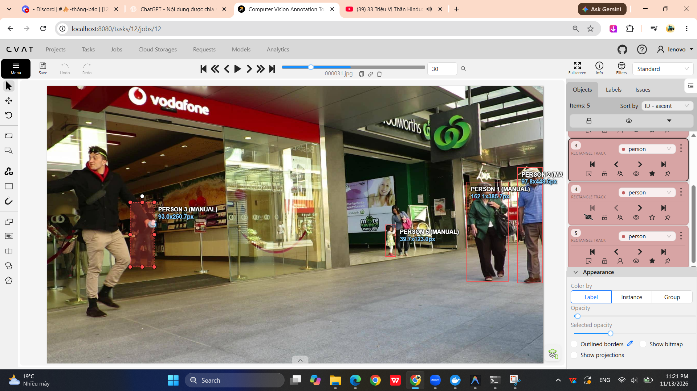
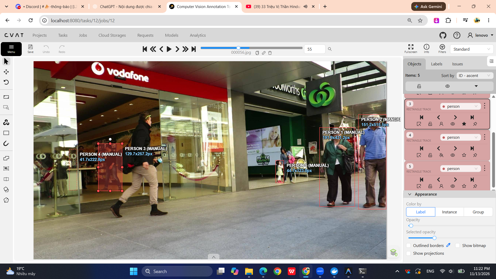

# Báo cáo cá nhân — LeDucLuong-2A202603137

Đổi tên file theo quy tắc `MSSV_HoTen.md`. Ví dụ: `20241234_NguyenVanAn.md`.

Đoạn video: MOT17-09, 150 frame (frame 1–150), nguồn MOTChallenge (Milan et al., 2016), giấy phép CC BY-NC-SA 3.0.

## 0. Thông tin học viên

- Họ tên: Lê Đức Lượng
- MSSV: `2A202603137`
- Mã đề (A/B/C): **A** (5 đối tượng mục tiêu: MOT ID `[1, 7, 19, 20, 21]`)
- Email: `haryluong1@gmail.com`
- Link repository: https://github.com/haryluong1/K5-L2-DAY05-LeDucLuong-2A202603137-MOTTracking
- Giờ bắt đầu: `17:10` (13/11/2026)
- Giờ kết thúc: `23:25` (13/11/2026)

> **Bảng quy chiếu ID giữa Đề A và file xuất CVAT:**
> - **P1** (Người đàn ông áo tối màu đi trong shop Vodafone): trên CVAT là **`PERSON 3`** (`annotations.xml`: `Track 2`, `gt.txt`: `Track 3`).
> - **P2** (Người đi bên trái trong shop Vodafone, xuất hiện từ frame 48): trên CVAT là **`PERSON 4`** (`annotations.xml`: `Track 3`, `gt.txt`: `Track 5`).
> - **P3** (Người phụ nữ áo khoác xanh lá đeo túi đen): trên CVAT là **`PERSON 1`** (`annotations.xml`: `Track 0`, `gt.txt`: `Track 1`).
> - **P4** (Người đàn ông áo xanh dương đội mũ trắng bên phải): trên CVAT là **`PERSON 2`** (`annotations.xml`: `Track 1`, `gt.txt`: `Track 2`).
> - **P5** (Bé gái váy trắng trước cửa Woolworths): trên CVAT là **`PERSON 5`** (`annotations.xml`: `Track 4`, `gt.txt`: `Track 4`).

## 1. Xem trước đoạn video (CP0)

Ghi **trước khi vẽ**, mỗi người một dòng.

| Mã | Frame xuất hiện | Frame cuối thấy được | Rẽ / dừng / đổi tốc độ ở frame | Bị che ở frame | Ghi chú |
|---|---:|---:|---|---|---|
| **P1** (`PERSON 3` / XML `Track 2`) | 0 | 149 | Đi ngang và xoay người trong cửa hàng khoảng frame 53–90 | Che một phần: `29–38`, `53`; mất hẳn (`outside`): `39–52` | Bị người đàn ông áo khoác đen quần kaki đi ngang qua trước cửa hàng Vodafone che khuất |
| **P2** (`PERSON 4` / XML `Track 3`) | 48 | 149 | Đi chậm và dừng/xoay nhẹ bên trái trong cửa hàng khoảng frame 68–128 | Che một phần (`occluded`): `48–67` | Lộ ra phía sau lưng người đàn ông áo khoác đen từ frame 48, bị quầy kệ/cửa kính che một phần ở đoạn đầu |
| **P3** (`PERSON 1` / XML `Track 0`) | 0 | 149 | Đi thẳng tiến lại gần camera, kích thước box tăng nhanh từ frame 30–149 | Không bị che | Người đầu tiên gán nhãn; do tiến sát camera nên kích thước và bước chân thay đổi liên tục |
| **P4** (`PERSON 2` / XML `Track 1`) | 0 | 149 | Bước vào từ mép phải khung hình (0–35), đi song song P3 về phía camera (40–149) | Không bị người khác che (bị cắt mép phải ở frame 0–25) | Đi sát bên phải P3, kích thước box mở rộng nhanh khi vào trọn khung hình và tiến gần camera |
| **P5** (`PERSON 5` / XML `Track 4`) | 0 | 145 | Đứng/bước nhỏ trước cửa Woolworths (0–100) | Che một phần: `109`, `144–145`; mất hẳn (`outside`): `110–139` và `146–149` | Ở xa camera (box nhỏ), đoạn cuối bị P3 và P4 tiến lại gần camera che khuất |

## 2. Keyframe và thời gian (CP1, CP4)

Số keyframe lấy từ kết quả `src/check_submission.py`.

| Mã | Số keyframe | Keyframe ở frame | Số frame có mặt | Keyframe / 100 frame | Thời gian (phút) | Chỗ khó |
|---|---:|---|---:|---:|---:|---|
| **P1** (`Track 2` XML / `Track 3` MOT) | 29 | `[0, 10, 20, 29, 30, 38, 53, 54, 55, 60, 69, 70, 73, 74, 76, 80, 83, 85, 87, 90, 94, 100, 103, 110, 116, 120, 130, 140, 149]` | 136 | 21.3 | 15′ | Bị che khuất hoàn toàn ở frame 39–52 và nhìn xuyên qua lớp kính cửa hàng Vodafone có bóng phản chiếu |
| **P2** (`Track 3` XML / `Track 5` MOT) | 12 | `[48, 58, 68, 78, 88, 98, 108, 118, 128, 138, 148, 149]` | 102 | 11.8 | 10′ | Xuất hiện muộn (frame 48) bên trong cửa hàng tối, bị che một phần ở đoạn 48–67 |
| **P3** (`Track 0` XML / `Track 1` MOT) | 121 | `[0..7, 10, 13, 14, 16..20, 24, 25, 29..35, 37, 40, 43..58, 60..66, 70..88, 90..97, 100, 102..124, 126, 127, 130..137, 140..149]` | 150 | 80.7 | 20′ | Là đối tượng đầu tiên thực hiện nên tinh chỉnh kỹ từng nhịp bước chân và độ nở kích thước khi tiến sát camera |
| **P4** (`Track 1` XML / `Track 2` MOT) | 36 | `[0, 10, 20, 24, 25, 28, 29, 30, 34, 35, 39, 40, 41, 45, 46, 50, 51, 60, 69, 70, 80, 85, 89, 90, 94, 100, 106, 110, 120, 124, 130, 138, 140, 142, 148, 149]` | 150 | 24.0 | 12′ | Đoạn đầu (frame 0–30) người mới bước vào từ mép phải ảnh nên chiều rộng box thay đổi phi tuyến tính |
| **P5** (`Track 4` XML / `Track 4` MOT) | 10 | `[0, 10, 20, 30, 40, 50, 100, 109, 140, 144]` | 116 | 8.6 | 10′ | Kích thước người rất nhỏ ở xa, bị P3 và P4 che khuất ngắt quãng ở đoạn frame 109–149 |
| **Tổng** | **208** | — | **654** | **31.8** | **67′** | — |

Keyframe / 100 frame của cả bài = tổng keyframe ÷ tổng số frame có mặt × 100 = `208 ÷ 654 × 100 = 31.8 keyframe / 100 frame`.

Bạn đặt keyframe nhiều nhất ở người nào? Vì sao (người đó rẽ, dừng, lại gần camera hay bị che)?

- Đặt keyframe nhiều nhất ở **P3** (`PERSON 1` trên CVAT / `Track 0` trong XML, với **121 keyframe** trên 150 frame — mật độ `80.7 KF / 100 frame`).
- **Lý do (kiêm giải trình cảnh báo `[CẢNH BÁO] Track 0: 81 keyframe / 100 frame > 50` của script):** P3 là đối tượng đầu tiên mình thực hiện trong bài lab và người này đi bộ trực diện từ xa tiến lại rất gần camera, làm kích thước bounding box phóng to nhanh và vung tay/bước chân đổi biên độ liên tục ở mỗi vài frame. Khi tua từng frame (`F`) để kiểm tra độ khít sát mép toàn thân, mình đã nắn lại box ở hầu hết các frame có dao động nhỏ nên tạo nhiều keyframe. Từ các đối tượng tiếp theo (P4, P1, P2, P5), mình đã rút kinh nghiệm tận dụng nội suy tuyến tính tốt hơn (mật độ giảm xuống còn `8.6 – 24.0 KF / 100 frame`).

## 3. Đoạn bị che (CP2)

Người bị che: **`P1`** (trên giao diện CVAT là **`PERSON 3`**, trong `gt.txt` là **`Track 3`**, trong `annotations.xml` là **`Track 2`**).

| Mốc | Frame |
|---|---:|
| Bắt đầu bị che một phần (bật `occluded`) | **29** (kéo dài từ frame 29 đến 38) |
| Mất hẳn (bật `outside`) | **39** (kéo dài từ frame 39 đến 52) |
| Hiện lại (tắt `outside`) | **53** (vẫn còn che một phần nhẹ ở frame 53) |
| Thấy rõ trở lại (tắt `occluded`) | **54** |

- Thời gian khuất hẳn: **14** frame (từ frame 39 đến hết frame 52) = **0,47** giây (ở 30 fps).
- Quyết định: **Giữ cùng ID** (`PERSON 3` trên CVAT / `Track 3` trong `gt.txt`).
- Lý do (trả lời 3 câu: khuất bao lâu so với 60 frame, ngoại hình có khớp, chỗ hiện lại có đúng hướng và tốc độ):
  1. **Thời gian khuất so với ngưỡng 60 frame (2 giây):** Chỉ khuất hoàn toàn 14 frame (≈ 0,47 giây), nhỏ hơn rất nhiều so với ngưỡng tối đa 60 frame (2 giây) của lớp.
  2. **Ngoại hình có khớp không:** Hoàn toàn khớp — vẫn là người đàn ông mặc áo tối màu, quần jean tối màu đi bên trong cửa hàng Vodafone.
  3. **Vị trí hiện lại có đúng hướng và tốc độ không:** Vị trí xuất hiện lại ở frame 53–54 khớp hợp lý với hướng di chuyển và vận tốc đi bộ trước khi bị chàng trai mặc áo khoác đen quần kaki đi ngang qua che khuất.

Ảnh chụp màn hình *(Nguồn ảnh nền: MOT17, MOTChallenge — Milan et al., 2016)*:





## 4. Tự review ID (CP3)

Lượt 1 theo người (đi ngược từ frame 149 về 0 trên CVAT), lượt 2 theo cảnh (nhảy 10 frame). Ít nhất 3 dòng; không có lỗi thì ghi một dòng "đã kiểm hai lượt, không lỗi".

Loại lỗi dùng đúng một trong 7 mã: `id_switch`, `fragmentation`, `lost`, `merge`, `false_track`, `drift`, `flag`.

| Frame | Mã người | Loại lỗi | Mô tả một câu | Phát hiện ở lượt | Đã sửa? |
|---:|---|---|---|---|---|
| 41–52 | P1 (`PERSON 3`) | `lost` | Khi bật `outside` ở frame 39–40, thẻ track ẩn khỏi cột Objects ở frame 41 làm chưa tắt được `outside` đúng frame người hiện lại; đã bật *Show all interpolation tracks* và mở lại track ở frame 53. | Lượt 1 | Có |
| 29–38 | P1 (`PERSON 3`) | `flag` | Đoạn P1 bắt đầu bị người áo khoác đen che một phần trước khi khuất hẳn cần bật cờ `occluded` (`Q`) và giữ nguyên kích thước box toàn thân ước lượng (amodal box). | Lượt 1 | Có |
| 60–90 | P1 (`PERSON 3`) | `drift` | Giữa hai keyframe cách 10 frame khi P1 đi chậm và đổi tư thế trong cửa hàng, box nội suy bị trôi nhẹ so với thân người nên đã chèn thêm keyframe tại các frame 73, 74, 76, 83, 85, 87. | Lượt 1 | Có |
| 109–145 | P5 (`PERSON 5`) | `flag` | Bé gái P5 ở cuối video bị P3 và P4 tiến gần camera che khuất hoàn toàn từ frame 110–139 và từ 146 trở đi, cần bật `occluded` ở frame 109, 144–145 và bật `outside` ở đoạn khuất hẳn. | Lượt 2 | Có |

Tổng hợp số lỗi theo loại:

| `id_switch` | `fragmentation` | `lost` | `merge` | `false_track` | `drift` | `flag` |
|---:|---:|---:|---:|---:|---:|---:|
| 0 | 0 | 1 | 0 | 0 | 1 | 2 |

Lỗi nào chỉ lượt 2 (theo cảnh) mới thấy, lượt 1 (theo người) không thấy? Vì sao?

- Lỗi tương tác che khuất giữa nhiều đối tượng (như việc **P3 và P4** tiến lại gần camera làm che khuất **P5** ở đoạn frame 109–149, hoặc kiểm tra xem có hai box của hai người đi sát nhau bị chồng lấn / quên bật `outside` khi bị người khác che lấp hay không) dễ phát hiện ở **Lượt 2 (theo cảnh)** hơn.
- **Vì sao:** Ở Lượt 1 khi chỉ tập trung nhìn theo một người duy nhất lùi từ cuối về đầu, người gán dễ chỉ chú ý độ bám của box trên người đó mà quên mất tương quan vị trí với các box khác trên toàn khung hình; trong khi Lượt 2 quan sát đồng thời cả 5 box trên cùng một cảnh nên thấy rõ ngay thời điểm box của người phía trước đè lên người phía sau.

## 5. File xuất và kết quả tự kiểm (CP4)

| Kiểm tra | Kết quả |
|---|---|
| Tên file MOT 1.1 | `src/exports/LeDucLuong_mot.zip` |
| Tên file CVAT for video 1.1 | `src/exports/LeDucLuong_cvat_video.zip` |
| Số track ID khác nhau trong `gt/gt.txt` (phải là 5) | **5** (`Track 1, 2, 3, 4, 5`) |
| Frame `outside` không có dòng trong `gt.txt` (đúng / sai) | **Đúng** (ví dụ Track 3 vắng ở frame CVAT 39–52 tức `frame_id` 40–53 trong `gt.txt` không có dòng nào) |
| Job đã completed trên CVAT máy cá nhân | **Đã completed** (Job #12) |

Dán phần tóm tắt in ra từ `src/check_submission.py`:

```text
Số frame in theo CVAT (bắt đầu từ 0). Trong gt.txt, frame_id = frame CVAT + 1.

=== File MOT 1.1: LeDucLuong_mot.zip ===
  Số track ID: 5   |   Tổng số box: 654
  [OK]        Đúng 5 track ID.

  Track | Frame có mặt | Số frame | Đoạn vắng (outside)
      1 |   0–149      |      150 | -
      2 |   0–149      |      150 | -
      3 |   0–149      |      136 | 39–52
      4 |   0–145      |      116 | 110–139
      5 |  48–149      |      102 | -


=== File CVAT for video 1.1: LeDucLuong_cvat_video.zip ===

  Track | Nhãn   | Frame thấy | Keyframe | KF/100 frame | Frame occluded | Lần bật outside
      0 | person |        150 |      121 |         80.7 |              0 |               0
              Track 0: keyframe ở frame [0, 1, 2, 3, 4, 5, 6, 7, 10, 13, 14, 16, 17, 18, 19, 20, 24, 25, 29, 30, 31, 32, 33, 34, 35, 37, 40, 43, 44, 45, 46, 47, 48, 49, 50, 51, 52, 53, 54, 55, 56, 57, 58, 60, 61, 62, 63, 64, 65, 66, 70, 71, 72, 73, 74, 75, 76, 77, 78, 79, 80, 81, 82, 83, 84, 85, 86, 87, 88, 90, 91, 92, 93, 94, 95, 96, 97, 100, 102, 103, 104, 105, 106, 107, 108, 109, 110, 111, 112, 113, 114, 115, 116, 117, 118, 119, 120, 121, 122, 123, 124, 126, 127, 130, 131, 132, 133, 134, 135, 136, 137, 140, 141, 142, 143, 144, 145, 146, 147, 148, 149]
  [CẢNH BÁO]  Track 0: 81 keyframe / 100 frame > 50. Quá dày, dồn keyframe vào chỗ rẽ / dừng / bị che.
      1 | person |        150 |       36 |         24.0 |              0 |               0
              Track 1: keyframe ở frame [0, 10, 20, 24, 25, 28, 29, 30, 34, 35, 39, 40, 41, 45, 46, 50, 51, 60, 69, 70, 80, 85, 89, 90, 94, 100, 106, 110, 120, 124, 130, 138, 140, 142, 148, 149]
      2 | person |        136 |       29 |         21.3 |             11 |               1
              Track 2: keyframe ở frame [0, 10, 20, 29, 30, 38, 53, 54, 55, 60, 69, 70, 73, 74, 76, 80, 83, 85, 87, 90, 94, 100, 103, 110, 116, 120, 130, 140, 149]
      3 | person |        102 |       12 |         11.8 |             20 |               0
              Track 3: keyframe ở frame [48, 58, 68, 78, 88, 98, 108, 118, 128, 138, 148, 149]
      4 | person |        116 |       10 |          8.6 |              3 |               2
              Track 4: keyframe ở frame [0, 10, 20, 30, 40, 50, 100, 109, 140, 144]

  Tổng: 208 keyframe / 654 frame có mặt = 31.8 keyframe / 100 frame
  [OK]        Đọc được 5 track từ annotations.xml.

=== Tóm tắt ===
  Lỗi: 0   |   Cảnh báo: 1
  Không có lỗi định dạng. Mở CVAT xem lại từng [CẢNH BÁO]; cảnh báo đúng ý bạn thì ghi lý do vào báo cáo.
```

## 6. Ba câu kết

1. Nếu được gán lại, bạn sẽ đặt keyframe khác ở đâu? Vì sao?

   - Nếu gán lại, mình sẽ **giảm mạnh số keyframe ở đối tượng P3 (`PERSON 1` / `Track 0`)** từ 121 keyframe xuống còn khoảng 15–18 keyframe (đặt mỗi 10 frame bằng phím `V` và chỉ thêm keyframe ở những nhịp đổi tốc độ hoặc mở rộng kích thước rõ rệt).
   - **Vì sao:** P3 đi bộ theo quỹ đạo khá thẳng về phía camera; việc chỉnh box trên hầu hết các frame liên tiếp ở lần đầu làm bài vừa tốn nhiều thời gian (20 phút), vừa dễ làm viền box rung nhẹ giữa các frame kế tiếp nhau, trong khi nội suy tuyến tính của CVAT hoàn toàn đáp ứng được độ khít `IoU ≥ 0,7` với mật độ thưa hơn nhiều.

2. Có chỗ nào bạn không chắc "cùng ID hay ID mới"? Bạn đã quyết định và ghi chú thế nào?

   - Chỗ phân vân nhất là ở **P5 (bé gái váy trắng — `PERSON 5` / `Track 4`)** khi bị hai người đi bộ phía trước (P3 và P4) che khuất hoàn toàn trong khoảng khá dài từ **frame 110 đến 139** (30 frame = 1,0 giây), rồi mới lộ lại một thoáng ở frame 140–145 trước khi khuất hẳn ở frame 146.
   - **Quyết định và ghi chú:** Áp dụng quy tắc 3 câu hỏi trong `GUIDELINE.md`, thời gian khuất là 30 frame (1 giây) vẫn **≤ ngưỡng 60 frame (2 giây)** của lớp, vị trí lộ ra ở khe giữa hai người đi bộ và trang phục váy trắng hoàn toàn khớp với bé gái trước đó nên mình quyết định **giữ nguyên cùng một Track ID (`PERSON 5`)**, dùng cờ `outside` ở đoạn 110–139 và bật lại box ở 140–145. Ngoài ra ở đầu video, **P4 (người áo xanh dương)** chỉ lộ một phần cánh tay sát mép phải ở frame 0–20 nhưng liên tục tiến vào khung hình nên mình giữ xuyên suốt một track từ frame 0 đến 149.

3. Một lỗi ID trong job của bạn (nếu không còn sót, chọn lỗi đã sửa) có thể làm xe tự lái dự đoán sai chuyển động của người đó như thế nào? Lỗi đó ảnh hưởng MOTA hay IDF1 nhiều hơn?

   - Xét lỗi **`lost` / `fragmentation` (hoặc `id_switch`) trên P1 (`PERSON 3`)** ở đoạn bị che khuất (frame 39–52): nếu khi P1 bước ra ở frame 53 mà tạo nhầm một Track ID mới (thành `fragmentation`), hoặc để track của P1 nhảy sang bám theo người đàn ông áo khoác đen đi ngang qua (thành `id_switch`), hệ thống dự đoán quỹ đạo (motion prediction / Kalman filter) của xe tự lái sẽ tính ra vận tốc ảo nhảy vọt đột ngột theo người áo khoác đen hoặc coi người vừa bước ra ở frame 53 là đối tượng mới xuất hiện tức thời (chưa có lịch sử vận tốc), dẫn đến dự đoán sai hướng đi và tốc độ của người đi bộ.
   - Lỗi đổi hoặc đứt ID này ảnh hưởng đến **IDF1 nhiều hơn rất nhiều so với MOTA**: trong công thức `MOTA = 1 − (FN + FP + IDSW) / GT`, 1 lần đổi ID tại 1 frame chỉ làm tử số tăng thêm 1 trên tổng số 654 box (MOTA chỉ giảm khoảng `0,15%`); ngược lại **IDF1** chấm điểm theo việc giữ đúng một định danh xuyên suốt toàn bộ quỹ đạo, nên nếu nửa sau của track bị đổi ID thì toàn bộ số frame của đoạn sau đều bị tính là `IDFN` và `IDFP`, kéo điểm IDF1 tụt xuống rất mạnh.

## 7. Tài liệu tham khảo và công cụ AI đã dùng

- **Tài liệu và dữ liệu:**
  - Bộ dữ liệu **MOT17 (MOT17-09)**, MOTChallenge — A. Milan, L. Leal-Taixé, I. Reid, S. Roth, K. Schindler (2016), *"MOT16: A Benchmark for Multi-Object Tracking"*, giấy phép **CC BY-NC-SA 3.0**.
  - Tài liệu hướng dẫn Lab Ngày 5 của khóa học (`README.md`, `docs/GUIDELINE.md`, `docs/MOT_FORMAT.md`, `CHECKPOINTS.md`, `tools/lab05/huong-dan-cvat.html`).
- **Công cụ AI đã dùng:**
  - Sử dụng trợ lý AI (Antigravity / Gemini & Claude) để hỗ trợ cài đặt thư viện môi trường `.venv`, giải đáp thao tác bật cài đặt *Show all interpolation tracks* khi xử lý cờ `outside` trên CVAT, chạy kiểm tra `src/check_submission.py` và rà soát trình bày báo cáo. Toàn bộ thao tác vẽ bounding box, đặt keyframe và quyết định Track ID trên 150 frame đều do cá nhân tự thực hiện thủ công trên CVAT local.
